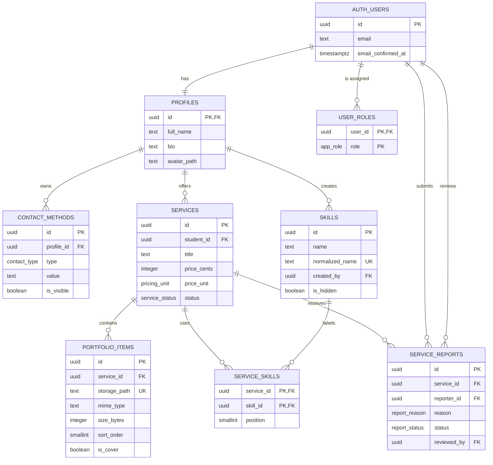

# UNI-TALENT database

UNI-TALENT uses the PostgreSQL database included with Supabase. Supabase Auth owns the `auth.users` table; application data lives in the `public` schema. Database structure and security rules are maintained in timestamped files under `supabase/migrations/`.

## Entity relationships



## Table responsibilities

| Table             | Responsibility                                                                  |
| ----------------- | ------------------------------------------------------------------------------- |
| `auth.users`      | Supabase-managed account, email confirmation, and login identity data           |
| `profiles`        | Publicly safe student information; created automatically after account creation |
| `contact_methods` | Email, phone, Instagram, or LinkedIn values with individual visibility controls |
| `services`        | Draft, published, archived, and administratively hidden service listings        |
| `skills`          | Normalized, reusable skill names                                                |
| `service_skills`  | Ordered many-to-many links between services and up to five skills               |
| `portfolio_items` | Metadata for up to six private Storage objects belonging to a service           |
| `service_reports` | Student reports and administrator review state                                  |
| `user_roles`      | Protected administrative role assignments                                       |

## Account lifecycle

1. The Before User Created hook accepts only the exact `sdsu.edu` email domain.
2. Supabase sends the student an email confirmation link.
3. The `on_auth_user_created` trigger creates the matching `profiles` row.
4. RLS access remains unavailable until the email is confirmed.
5. Deleting the Auth user cascades to their profile and owned application data.

`raw_user_meta_data.full_name` is treated as untrusted input. The provisioning function trims it and stores it only when its length satisfies the profile constraint.

## Security boundaries

- Anonymous visitors have no database-table privileges. The public landing page uses static content.
- A student is considered verified only when `auth.users.email_confirmed_at` is present and the stored email matches the exact `sdsu.edu` domain.
- Verified students can read published listings, safe profiles, visible contacts, and related skills and portfolio metadata.
- Owners manage their own profiles, contacts, listings, skill links, and portfolio metadata.
- Draft and archived services are visible only to their owner and administrators. Hidden services are unavailable to ordinary students.
- Reporters can submit one report per service, cannot report themselves, and can read their own submissions.
- Administrative capabilities come from `user_roles`, which ordinary application users cannot modify.
- The secret Supabase key bypasses RLS and must remain server-only.

## Local development data

`supabase/seed.sql` creates fictional, confirmed SDSU accounts and representative services whenever the local database is started for the first time or reset.

All local demo accounts use this password:

```text
UniTalentDemo123!
```

| Email                           | Purpose                                                 |
| ------------------------------- | ------------------------------------------------------- |
| `demo.unitalent.01@sdsu.edu`    | Photography provider with a published service and draft |
| `demo.unitalent.02@sdsu.edu`    | Tutoring provider with published and archived services  |
| `demo.unitalent.03@sdsu.edu`    | Design provider with paid and free published services   |
| `demo.unitalent.admin@sdsu.edu` | Administrator with a seeded report to review            |

The seed contains no real people or production information. It intentionally contains no portfolio rows until Storage-backed development images are added. Never run `supabase db push --include-seed` against production.

## Development workflow

```bash
npm run supabase:start
npm run db:reset
npm run db:test
npm run db:lint
npm run supabase:stop
```

- `db:reset` destroys only the local database because the package script includes `--local`, then reapplies every migration and the seed file.
- Permanent schema changes belong in a new timestamped migration, not in the hosted Table Editor.
- `db:test` runs the pgTAP access-policy suite.
- Deploy pending migrations only after review with `supabase db push`; seed data requires a separate explicit `--include-seed` flag.
